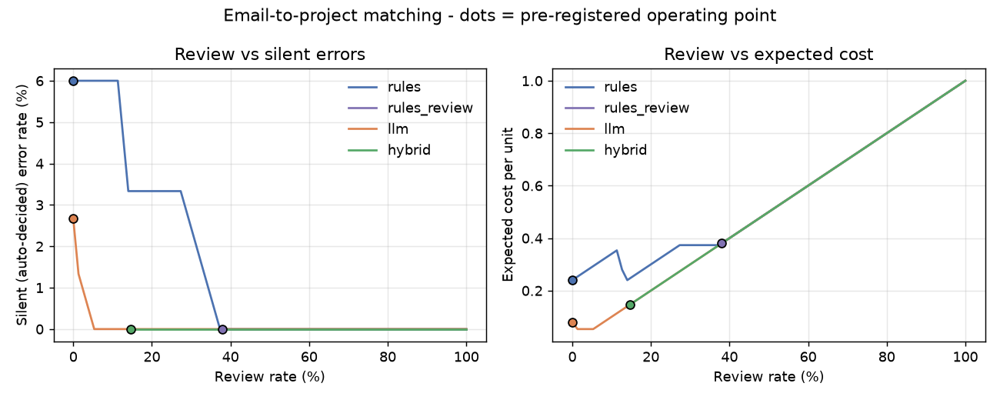
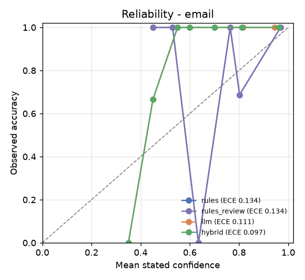
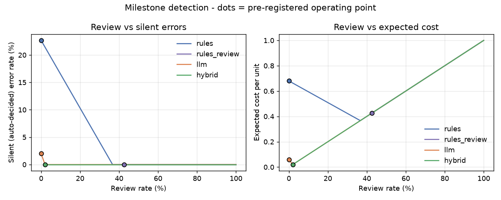
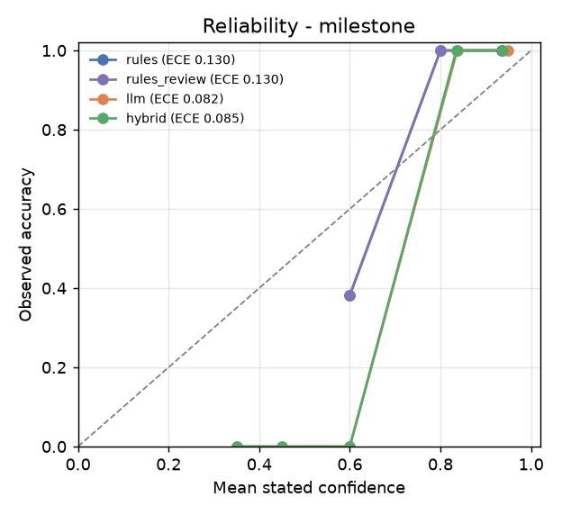
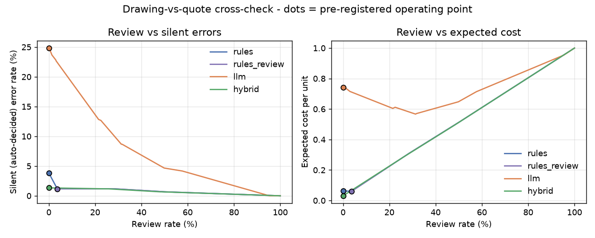
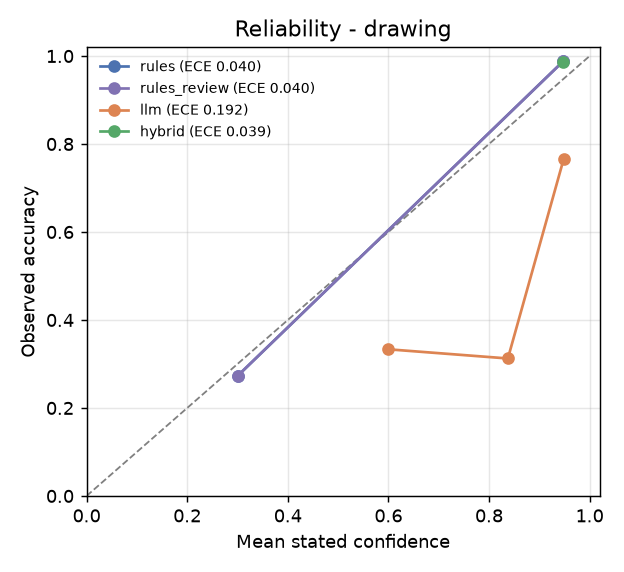

# Results

Generated by `bench report`. Units: email/milestone = one per item; drawing = four per item (one per field).

| Task | Pipeline | Accuracy (95% CI) | Macro-F1 | Review rate | Silent-error rate | Cost/unit (95% CI) | ECE | LLM calls | USD/item | Latency p50 |
|---|---|---|---|---|---|---|---|---|---|---|
| email | rules | 94.0% (90.0%-97.3%) | 0.950 | 0.0% | 6.0% | 0.24 (0.09-0.43) | 0.134 | 0.0% | $0.0000 | 0.00 ms |
| email | rules_review | 94.0% (90.0%-97.3%) | 0.950 | 38.0% | 0.0% | 0.38 (0.31-0.46) | 0.134 | 0.0% | $0.0000 | 0.00 ms |
| email | llm | 97.3% (94.0%-99.3%) | 0.975 | 0.0% | 2.7% | 0.08 (0.02-0.18) | 0.111 | 100.0% | $0.0001 | 1225.36 ms |
| email | hybrid | 97.3% (94.0%-99.3%) | 0.975 | 14.7% | 0.0% | 0.15 (0.09-0.20) | 0.097 | 38.0% | $0.0000 | 0.00 ms |
| milestone | rules | 77.3% (70.7%-84.0%) | 0.770 | 0.0% | 22.7% | 0.68 (0.48-0.88) | 0.130 | 0.0% | $0.0000 | 0.00 ms |
| milestone | rules_review | 77.3% (70.7%-84.0%) | 0.770 | 42.7% | 0.0% | 0.43 (0.35-0.51) | 0.130 | 0.0% | $0.0000 | 0.00 ms |
| milestone | llm | 98.0% (95.3%-100.0%) | 0.979 | 0.0% | 2.0% | 0.06 (0.00-0.14) | 0.082 | 100.0% | $0.0000 | 1199.59 ms |
| milestone | hybrid | 98.0% (95.3%-100.0%) | 0.979 | 2.0% | 0.0% | 0.02 (0.00-0.05) | 0.085 | 42.7% | $0.0000 | 0.00 ms |
| drawing | rules | 96.2% (94.7%-97.7%) | 0.954 | 0.0% | 3.8% | 0.06 (0.04-0.09) | 0.040 | 0.0% | $0.0000 | 0.03 ms |
| drawing | rules_review | 96.2% (94.7%-97.7%) | 0.954 | 3.7% | 1.2% | 0.06 (0.04-0.08) | 0.040 | 0.0% | $0.0000 | 0.03 ms |
| drawing | llm | 75.2% (72.3%-78.3%) | 0.670 | 0.0% | 24.8% | 0.74 (0.60-0.90) | 0.192 | 100.0% | $0.0001 | 1189.80 ms |
| drawing | hybrid | 98.7% (97.7%-99.5%) | 0.980 | 0.0% | 1.3% | 0.03 (0.01-0.06) | 0.039 | 14.7% | $0.0000 | 0.03 ms |

## Email-to-project matching

Accuracy by case:

| Case | n | rules acc | rules_review acc | llm acc | hybrid acc |
|---|---|---|---|---|---|
| bare_number | 14 | 100.0% | 100.0% | 100.0% | 100.0% |
| contact_shared_hint | 8 | 100.0% | 100.0% | 100.0% | 100.0% |
| contact_unique | 8 | 100.0% | 100.0% | 75.0% | 75.0% |
| domain_place | 6 | 100.0% | 100.0% | 100.0% | 100.0% |
| erp_opp | 8 | 100.0% | 100.0% | 100.0% | 100.0% |
| forwarded | 14 | 100.0% | 100.0% | 100.0% | 100.0% |
| internal_noise | 4 | 100.0% | 100.0% | 100.0% | 100.0% |
| newsletter | 9 | 100.0% | 100.0% | 100.0% | 100.0% |
| newsletter_client_case_study | 4 | 50.0% | 50.0% | 100.0% | 100.0% |
| project_number | 9 | 100.0% | 100.0% | 100.0% | 100.0% |
| redirected_thread | 4 | 100.0% | 100.0% | 100.0% | 100.0% |
| thread_reply | 17 | 100.0% | 100.0% | 100.0% | 100.0% |
| two_projects | 8 | 100.0% | 100.0% | 100.0% | 100.0% |
| typo_number | 6 | 83.3% | 83.3% | 66.7% | 66.7% |
| unrelated_vendor | 10 | 100.0% | 100.0% | 100.0% | 100.0% |
| unseen:misspelt_place | 4 | 50.0% | 50.0% | 100.0% | 100.0% |
| unseen:third_party | 8 | 50.0% | 50.0% | 100.0% | 100.0% |
| vendor_order | 9 | 100.0% | 100.0% | 100.0% | 100.0% |

## Milestone detection

Accuracy by case:

| Case | n | rules acc | rules_review acc | llm acc | hybrid acc |
|---|---|---|---|---|---|
| notice:new_opportunity | 10 | 100.0% | 100.0% | 100.0% | 100.0% |
| notice:our_po_to_vendor | 5 | 100.0% | 100.0% | 100.0% | 100.0% |
| notice:out_of_office | 5 | 100.0% | 100.0% | 100.0% | 100.0% |
| notice:po_acceptance | 14 | 100.0% | 100.0% | 100.0% | 100.0% |
| notice:portal_reminder | 9 | 100.0% | 100.0% | 100.0% | 100.0% |
| notice:reply_to_notice | 4 | 100.0% | 100.0% | 100.0% | 100.0% |
| notice:ship_changed | 23 | 100.0% | 100.0% | 100.0% | 100.0% |
| notice:ship_unchanged | 8 | 100.0% | 100.0% | 100.0% | 100.0% |
| notice:vendor_b_submittals | 12 | 100.0% | 100.0% | 100.0% | 100.0% |
| prose:award | 2 | 0.0% | 0.0% | 100.0% | 100.0% |
| prose:customer_po | 9 | 100.0% | 100.0% | 100.0% | 100.0% |
| prose:hedged_order | 5 | 100.0% | 100.0% | 100.0% | 100.0% |
| prose:meeting_notes | 5 | 100.0% | 100.0% | 100.0% | 100.0% |
| prose:rfq | 12 | 0.0% | 0.0% | 75.0% | 75.0% |
| prose:ship_moved | 10 | 0.0% | 0.0% | 100.0% | 100.0% |
| prose:submittal_request | 7 | 100.0% | 100.0% | 100.0% | 100.0% |
| prose:submittals_approved | 10 | 0.0% | 0.0% | 100.0% | 100.0% |

## Drawing-vs-quote cross-check

Accuracy by case:

| Case | n | rules acc | rules_review acc | llm acc | hybrid acc |
|---|---|---|---|---|---|
| boundary | 104 | 100.0% | 100.0% | 70.2% | 100.0% |
| boundary+unseen_format | 40 | 90.0% | 90.0% | 67.5% | 92.5% |
| standard | 296 | 100.0% | 100.0% | 76.4% | 100.0% |
| standard+unseen_format | 160 | 88.1% | 88.1% | 78.1% | 96.9% |

