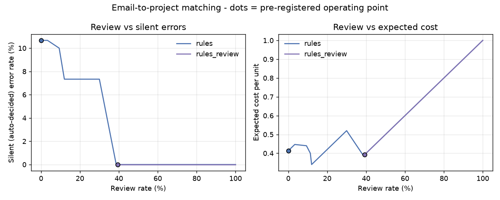
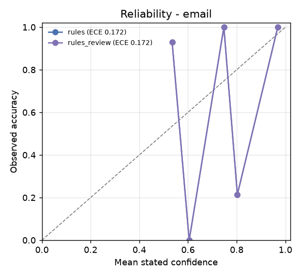
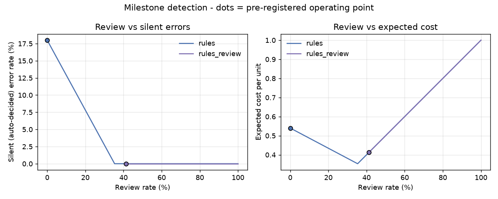
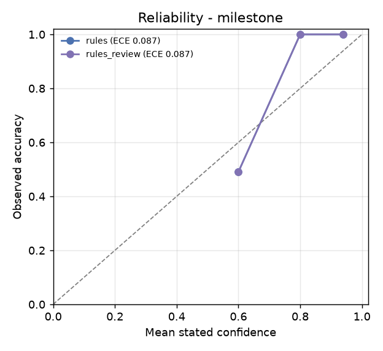
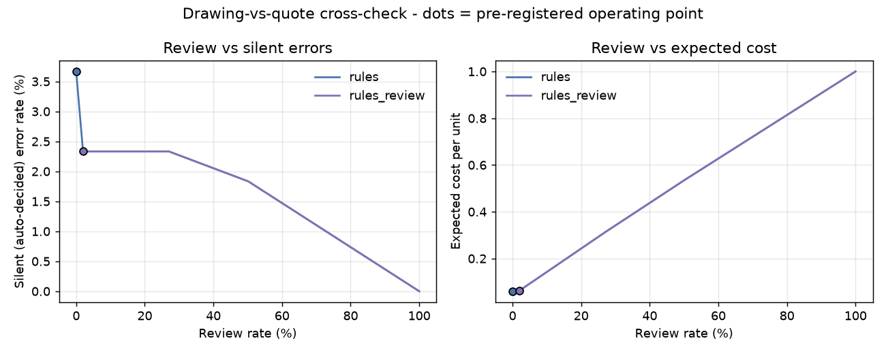
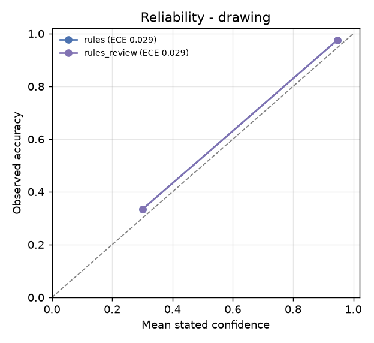

# Results

Generated by `bench report`. Units: email/milestone = one per item; drawing = four per item (one per field).

| Task | Pipeline | Accuracy (95% CI) | Macro-F1 | Review rate | Silent-error rate | Cost/unit (95% CI) | ECE | LLM calls | USD/item | Latency p50 |
|---|---|---|---|---|---|---|---|---|---|---|
| email | rules | 89.3% (84.7%-94.0%) | 0.908 | 0.0% | 10.7% | 0.41 (0.22-0.63) | 0.172 | 0.0% | $0.0000 | 0.00 ms |
| email | rules_review | 89.3% (84.7%-94.0%) | 0.908 | 39.3% | 0.0% | 0.39 (0.32-0.47) | 0.172 | 0.0% | $0.0000 | 0.00 ms |
| milestone | rules | 82.0% (76.0%-88.7%) | 0.835 | 0.0% | 18.0% | 0.54 (0.34-0.72) | 0.087 | 0.0% | $0.0000 | 0.00 ms |
| milestone | rules_review | 82.0% (76.0%-88.7%) | 0.835 | 41.3% | 0.0% | 0.41 (0.33-0.49) | 0.087 | 0.0% | $0.0000 | 0.00 ms |
| drawing | rules | 96.3% (94.8%-97.7%) | 0.953 | 0.0% | 3.7% | 0.06 (0.04-0.09) | 0.029 | 0.0% | $0.0000 | 0.03 ms |
| drawing | rules_review | 96.3% (94.8%-97.7%) | 0.953 | 2.0% | 2.3% | 0.06 (0.04-0.09) | 0.029 | 0.0% | $0.0000 | 0.03 ms |

## Email-to-project matching

Accuracy by case:

| Case | n | rules acc | rules_review acc |
|---|---|---|---|
| bare_number | 8 | 100.0% | 100.0% |
| contact_shared_hint | 10 | 100.0% | 100.0% |
| contact_unique | 7 | 100.0% | 100.0% |
| domain_place | 15 | 100.0% | 100.0% |
| erp_opp | 4 | 100.0% | 100.0% |
| forwarded | 12 | 91.7% | 91.7% |
| internal_noise | 5 | 100.0% | 100.0% |
| newsletter | 11 | 100.0% | 100.0% |
| newsletter_client_case_study | 1 | 100.0% | 100.0% |
| project_number | 20 | 100.0% | 100.0% |
| redirected_thread | 2 | 100.0% | 100.0% |
| thread_reply | 13 | 100.0% | 100.0% |
| two_projects | 5 | 100.0% | 100.0% |
| typo_number | 7 | 57.1% | 57.1% |
| unrelated_vendor | 2 | 100.0% | 100.0% |
| unseen:misspelt_place | 6 | 0.0% | 0.0% |
| unseen:third_party | 8 | 25.0% | 25.0% |
| vendor_order | 14 | 100.0% | 100.0% |

## Milestone detection

Accuracy by case:

| Case | n | rules acc | rules_review acc |
|---|---|---|---|
| notice:new_opportunity | 12 | 100.0% | 100.0% |
| notice:our_po_to_vendor | 10 | 100.0% | 100.0% |
| notice:po_acceptance | 16 | 100.0% | 100.0% |
| notice:portal_reminder | 2 | 100.0% | 100.0% |
| notice:reply_to_notice | 14 | 100.0% | 100.0% |
| notice:ship_changed | 21 | 100.0% | 100.0% |
| notice:ship_unchanged | 8 | 100.0% | 100.0% |
| notice:vendor_b_submittals | 19 | 100.0% | 100.0% |
| prose:award | 6 | 0.0% | 0.0% |
| prose:customer_po | 9 | 100.0% | 100.0% |
| prose:hedged_order | 4 | 100.0% | 100.0% |
| prose:meeting_notes | 5 | 100.0% | 100.0% |
| prose:rfq | 4 | 0.0% | 0.0% |
| prose:ship_moved | 5 | 0.0% | 0.0% |
| prose:submittal_request | 3 | 100.0% | 100.0% |
| prose:submittals_approved | 12 | 0.0% | 0.0% |

## Drawing-vs-quote cross-check

Accuracy by case:

| Case | n | rules acc | rules_review acc |
|---|---|---|---|
| boundary | 92 | 100.0% | 100.0% |
| boundary+unseen_format | 52 | 86.5% | 86.5% |
| standard | 276 | 100.0% | 100.0% |
| standard+unseen_format | 180 | 91.7% | 91.7% |

